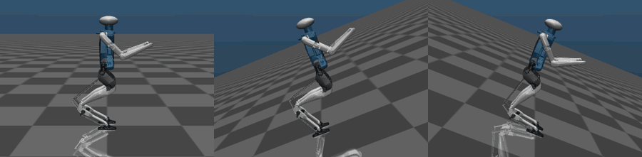
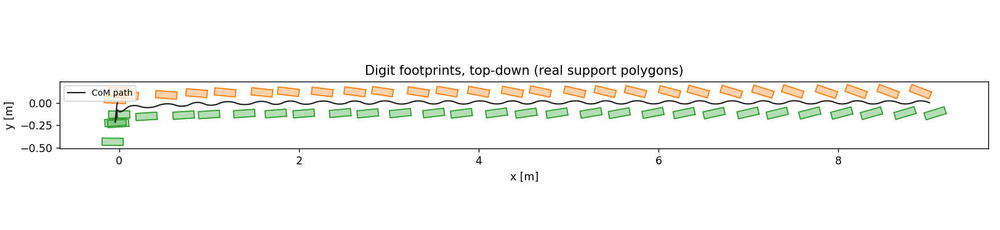

<div align="center">

# ALIP Walking Control for the Digit Humanoid

**Closed-loop bipedal walking on flat ground and ±22° slopes in MuJoCo, using an angular-momentum footstep planner (ALIP) and a whole-body QP controller.**




*Live physics, closed loop: flat ground · +22° uphill · −22° downhill. Nothing is precomputed.*

</div>

---

## Highlights

- **57 continuous steps on flat ground (9.04 m).** Commanded 0.500 m/s, measured 0.499 m/s, with CoM height held to ±4 mm and torso tilt under 0.52°.
- **Slopes from +22° uphill (40% grade) to −22° downhill.** The flat-ground controller is extended with a closed-form affine shift, with no MPC and no online trajectory optimization.
- **Two-layer architecture.** A reduced-order **ALIP** planner chooses each footstep from measured angular momentum about the contact point. A **whole-body QP** then solves for accelerations, contact forces, loop-closure forces and torques under the true constrained dynamics, friction cones and actuator limits.
- **Robot-agnostic planner.** The same planner module drove both Cassie and Digit **byte-for-byte unchanged**. Everything robot-specific is in the params, IK and state modules.
- **Every layer checked against an independent oracle.** Examples: the closed-form ALIP matches RK4 to 1e-9, the dynamics terms match MuJoCo's own q̈ to 1e-8, and angular momentum matches a hand-rolled sum over all bodies to 1e-8. **88 tests.**

---

## Results

### Flat ground

| Metric | Result |
|---|---|
| Steps / distance | **57 / 9.04 m** in 20 s |
| Commanded → measured speed | **0.500 → 0.499 m/s** |
| CoM height variation | ±4 mm |
| Max torso tilt | 0.52° |
| QP failures | 0 |

<p align="center"></p>

### Slopes

| Grade | Result | Limiting factor |
|---|---|---|
| **+22°** (40% grade) | walks: 33 steps, 1.42 m of vertical climb, 0.402 m/s vs 0.400 commanded | — |
| +25° | falls | knee torque (231 N·m) |
| **−22°** | walks: 31 steps, 1.12 m of descent | — |
| −30° | runs away to 1.27 m/s | braking authority |

**The asymmetry is the interesting result.** Uphill, the robot fails by *falling* because the knees saturate and it can't push hard enough. Downhill, it fails by *not tracking*, because foot placement alone can't brake. Downhill is where ankle-torque MPC would earn its keep.

The slope model is checked independently: measured ground reaction **F<sub>z</sub>/W matches cos γ to 0.2%** at every grade, and nothing in the controller was told to produce that.

### Why balance needs more than tracking

<p align="center"></p>

The baseline is joint PD holding the nominal pose. Knee tracking error is only 2.5°, nothing saturates, and the robot **falls anyway**, because nothing regulates the CoM over the support polygon. That's why the controller is built around foot placement.

---

## How it works

```
           measured state (CoM, angular momentum about the stance contact)
                                   │
                                   ▼
  ┌──────────────────────────────────────────────────────────────┐
  │  ALIP footstep planner          src/alip.py                  │
  │  closed-form deadbeat foot placement, one step ahead         │
  └──────────────────────────────────────────────────────────────┘
                                   │  next footstep
                                   ▼
  ┌──────────────────────────────────────────────────────────────┐
  │  Swing / reference generation   src/gait.py                  │
  │  pelvis + swing-foot targets every control tick              │
  └──────────────────────────────────────────────────────────────┘
                                   │  task targets
                                   ▼
  ┌──────────────────────────────────────────────────────────────┐
  │  Whole-body QP (OSC)            src/osc.py  (OSQP, 500 Hz)   │
  │  z = [ q̈ | contact forces | loop-closure forces | τ ]         │
  │  s.t. dynamics, stance no-slip, closed chains,               │
  │       friction cones, f_z ≥ 0, |τ| ≤ τ_max                   │
  └──────────────────────────────────────────────────────────────┘
                                   │  motor torques
                                   ▼
                     MuJoCo: Digit, 50 DOF, 20 motors
```

**The core idea.** Angular momentum about the contact point **L** passes through foot impact unchanged, because the impact force acts *at* that point. That makes the step-to-step map linear, so the footstep that puts **L** on target one step later has a closed form:

```math
p = x(T) + \frac{\cosh(\omega T)\,L(T) - L_{des}}{mH\omega\sinh(\omega T)}, \qquad \omega=\sqrt{g/H}
```

**Slopes cost two substitutions.** A constant grade γ adds a constant term to the momentum dynamics, which makes the system *affine* rather than nonlinear. Shifting to the equilibrium **x\* = H tan γ** recovers the flat-ground equations exactly, so the whole flat toolkit carries over.

The full derivations, the model audit (four silent failure modes found in the MJCF), the three bugs that mattered, and the limitations are in **[docs/PROJECT_REPORT.md](docs/PROJECT_REPORT.md)**.

---

## Quick start

```bash
git clone https://github.com/AdityaRampal26/Digit-Path-Planning-Optimization-ALIP-.git
cd Digit-Path-Planning-Optimization-ALIP-

bash setup.sh                 # venv + dependencies (+ clones the Cassie model used by the early stages)
source .venv/bin/activate
```

### Run it

```bash
# Watch the closed-loop walk live (macOS: mjpython; Linux: python)
mjpython sim/play_digit_physics.py --speed 0.5
mjpython sim/play_digit_physics.py --speed 0.4 --slope-deg 22

# Headless runs, with metrics printed at the end
python sim/digit_walk.py --seconds 20 --speed 0.5               # flat ground
python sim/digit_walk.py --seconds 10 --speed 0.4 --slope-deg 22  # uphill
python sim/digit_stand.py --seconds 30 --push 120               # standing + push recovery

# Capability envelope: grade vs pass/fail and torque utilization
python sim/sweep_envelope.py --grades -30 -22 0 10 22 25 --plot

# Render GIFs/videos (needs OpenGL), or skeleton plots without it
python sim/record_video.py --all --gif
python sim/render_digit.py --qpos digit_walk_physics_qpos.npy --name walk
```

Outputs (trajectories, plots, GIFs) are written to `out/`, which isn't tracked.

### Tests

```bash
python -m pytest tests -q          # 88 tests: ALIP math, dynamics, IK, estimator, OSC, slopes
```

---

## Repository layout

```
├── src/                      # the controller
│   ├── alip.py               #   ALIP model + deadbeat footstep planner (robot-agnostic)
│   ├── gait.py               #   footstep plan → pelvis and swing-foot references
│   ├── osc.py                #   whole-body QP (operational-space control) via OSQP
│   ├── walk_controller.py    #   estimator → planner → swing → OSC → torques
│   ├── dynamics.py           #   constrained dynamics terms pulled from MuJoCo
│   ├── digit_params.py       #   Digit model audit, actuation map, torque limits, foot geometry
│   ├── digit_ik.py           #   leg IK with closed-loop (four-bar) constraints
│   ├── digit_state.py        #   ALIP state estimation + contact detection
│   ├── digit_visual.py       #   color scheme for the Digit meshes
│   └── cassie_*.py           #   earlier Cassie stage (params, IK, state estimation)
│
├── sim/                      # runnable experiments
│   ├── alip_pointmass.py     #   stage 1: planner on a point mass
│   ├── digit_stand.py        #   stage A gate: OSC holds Digit standing, push recovery
│   ├── digit_one_leg.py      #   single-support balance test
│   ├── digit_walk.py         #   stage B gate: closed-loop walking (flat or slope)
│   ├── play_digit_physics.py #   live closed-loop walk in the MuJoCo viewer
│   ├── sweep_envelope.py     #   grade sweep → capability envelope
│   └── ...                   #   playback, rendering, recording, tuning tools
│
├── tests/                    # 88 tests against independent oracles
├── digit-model/              # Digit MJCF + meshes (and ramp variants)
├── docs/PROJECT_REPORT.md    # full write-up: derivations, results, bugs, limitations
├── media/                    # images and GIFs used in the docs
└── setup.sh · requirements.txt
```

---

## Limitations

- **Ground-truth state.** The planner reads CoM and angular momentum from the simulator. Real hardware would need a Kalman filter fusing IMU and encoders, and this is the biggest gap to a real robot.
- **Known, constant grade.** The planner is told the slope angle. Real terrain is unknown and varies.
- **Straight lines only.** Torso yaw is fixed, so there's no turning yet.
- **Simulation only.** Contacts, torque limits and closed chains are modeled, but this is MuJoCo, not hardware.

---

## References & credits

- Y. Gong and J. Grizzle, *"One-Step Ahead Prediction of Angular Momentum about the Contact Point for Control of Bipedal Locomotion,"* ICRA 2021. This is the ALIP model and foot-placement law this work builds on.
- Cassie MuJoCo model: [osudrl/cassie-mujoco-sim](https://github.com/osudrl/cassie-mujoco-sim) (cloned by `setup.sh`, not redistributed here).
- Digit is a humanoid robot by [Agility Robotics](https://agilityrobotics.com). The MJCF in `digit-model/` is a simulation model of it, and the torque limits come from Agility's published figures.
- Simulation: [MuJoCo](https://mujoco.org). QP solver: [OSQP](https://osqp.org).

This is an independent project and is not affiliated with or endorsed by Agility Robotics.

## License

The code is released under the [MIT License](LICENSE). Third-party models keep their original terms.

---

<p align="center">Built by <b>Aditya Rampal</b> · <a href="https://autonomousadi.com">autonomousadi.com</a></p>
