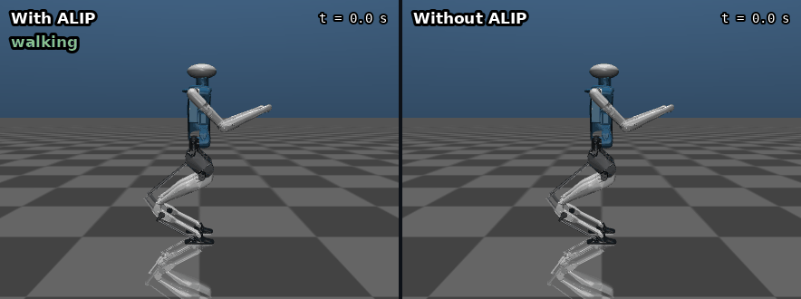
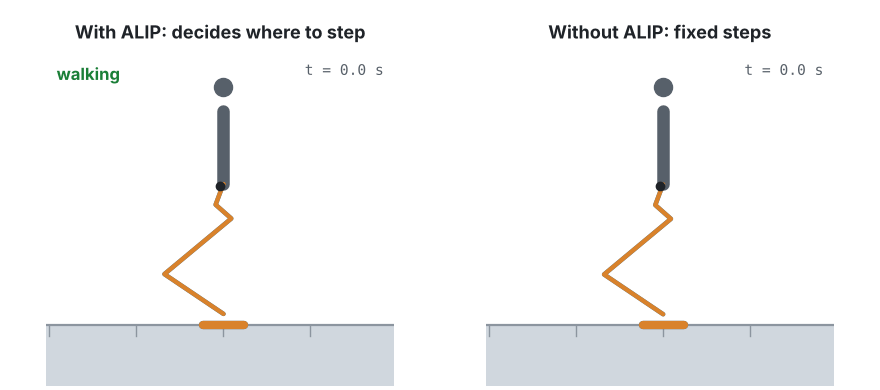
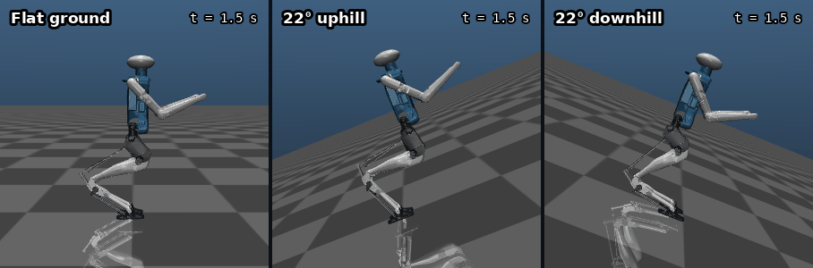
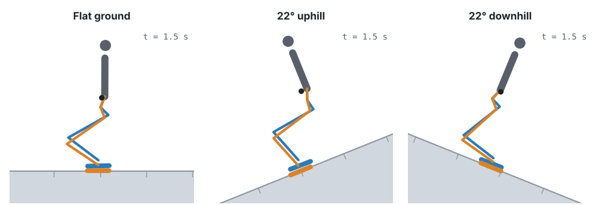

<div align="center">

# ALIP Walking Control for the Digit Humanoid

**Bipedal walking on flat ground and steep slopes in MuJoCo: an angular-momentum footstep planner paired with a whole-body optimization controller.**


*Live physics: flat ground · 22° uphill · 22° downhill*

</div>

## What is this?

[Digit](https://agilityrobotics.com) is a human-sized, two-legged robot built by Agility Robotics. This project teaches a simulated Digit to walk on its own, in the MuJoCo physics simulator.

Walking on two legs is hard because a biped is always falling. Its body sits high above two small feet, so the slightest lean grows into a fall unless the robot catches itself. People do this without thinking: when you start to tip forward, you put a foot out in front of you. **The whole trick of walking is choosing where to put the next foot.**

Nothing in the simulation is pre-recorded. Every footstep is decided while the robot is moving, from what its sensors measure in that moment.

## Why ALIP? What happens without it

**ALIP** (Angular-momentum Linear Inverted Pendulum) is a simple model of a walking robot: a single heavy point balanced on a stick, pivoting on the foot that's on the ground. From how fast the robot is rotating about that foot, ALIP predicts where the body will be at the end of the step. From that prediction, it calculates exactly where the next foot must land so the robot stays balanced one step later.

Both robots below run the same body controller and get the same speed command. The only difference is who picks the footsteps:

<p align="center"></p>

<p align="center"><i>The same two runs as a 2D side view, so you can follow the legs and the center of mass:</i></p>

<p align="center">
  <picture>
    <source media="(prefers-color-scheme: dark)" srcset="images/anim_alip_vs_none_dark.gif">
    
  </picture>
</p>

- **With ALIP (left):** each step lands where the planner says, so small wobbles get corrected on the next step.
- **Without ALIP (right):** the foot always lands one fixed stride ahead, whatever the body is doing. The first small wobble isn't corrected, it grows, and Digit falls over about 1 second in, after 3 steps.

## How it walks

Two layers work together, many times a second:

1. **Where to step: the ALIP planner.** It reads the robot's measured state, predicts where the body is heading, and picks the next footstep. It re-plans continuously during each step, so a push or stumble moves the target in real time.
2. **How to move: a whole-body controller.** 500 times a second, it solves an optimization problem (a QP) for the motor torque at every joint. The goal is to swing the free foot to the planned spot and keep the torso upright, without breaking real physics: feet can only push on the ground, not pull; the feet can't slip past their friction limit; and every motor has a maximum torque.

```
 measured state ─► ALIP planner ─► swing-foot targets ─► whole-body QP ─► joint torques ─► Digit (MuJoCo)
      ▲                (where to step)                     (how to move)                        │
      └─────────────────────────────────────────────────────────────────────────────────────────┘
```

**Slopes.** The original ALIP math assumes flat ground. On a hill, gravity also pulls the robot along the slope, so I added that pull into the model as a constant extra torque. That one change lets the same planner walk up and down 22° grades, with no heavier optimizer needed.

<p align="center"></p>

<p align="center">
  <picture>
    <source media="(prefers-color-scheme: dark)" srcset="images/anim_terrains_dark.gif">
    
  </picture>
</p>

*2D side view, drawn from the simulation. Orange = left leg, blue = right leg, dot = center of mass. Notice Digit leaning into the hill on the uphill run.*

## Results

| | Result |
|---|---|
| Flat ground | **57 steps / 9 m** without falling, commanded 0.50 m/s, measured 0.499 m/s |
| Stability | body height held to ±4 mm, torso tilt under 0.52° |
| Uphill | walks up **22°** (a 40% grade), 1.42 m of vertical climb |
| Downhill | walks down **22°** |
| Limits | falls at +25° (knees max out), speeds up uncontrollably at −30° (can't brake) |

<p align="center"></p>

*Top-down view of a 57-step walk. Each box is where a foot landed; the black line is the body swaying from foot to foot.*

## What's in the repo

| Folder | What's inside |
|---|---|
| [`src/`](src/) | The controller: ALIP planner, whole-body QP, inverse kinematics, state estimation |
| [`scripts/`](scripts/) | Things to run: watch it walk, experiments, and the scripts that make the visuals |
| [`models/`](models/) | The Digit robot model (MuJoCo XML + 3D part meshes) |
| [`tests/`](tests/) | 88 tests, each layer checked against something independent |
| [`docs/`](docs/PROJECT_REPORT.md) | The full write-up: derivations, the bugs that mattered, limitations |

Each folder has its own README with a file-by-file description.

## Run it

```bash
bash setup.sh && source .venv/bin/activate
mjpython scripts/play_digit_physics.py --speed 0.5     # watch it walk (Linux: python)
python -m pytest tests -q                               # run the tests
python scripts/make_gifs.py                             # redraw the 2D animations
```

<details>
<summary><b>Glossary</b> (for anyone new to legged robots)</summary>

- **Biped:** a robot that walks on two legs.
- **Stance foot / swing foot:** the foot on the ground, and the one moving through the air.
- **Center of mass (CoM):** the robot's average position, weighted by mass. Balance is about keeping it under control.
- **Inverted pendulum:** a weight balanced on top of a stick, like balancing a broom on your hand. A walking robot behaves a lot like one.
- **Angular momentum:** how much rotation the body has about the stance foot. ALIP uses it because it is smooth and easy to predict.
- **QP (quadratic program):** a kind of optimization problem that can be solved very fast, here hundreds of times a second.
- **Inverse kinematics (IK):** working backwards from "put the foot here" to the joint angles that do it.
- **MuJoCo:** the physics simulator that plays the role of the real world.

</details>

## Citation

If you use this controller in your work, please cite it:

```bibtex
@software(rampal2026alipdigit,
  author = {Rampal, Aditya},
  title = {{ALIP Walking Control for Digit: an angular-momentum footstep planner and whole-body QP controller for bipedal walking on slopes in MuJoCo}},
  url = {https://github.com/AdityaRampal26/Digit-Path-Planning-Optimization-ALIP-},
  year = {2026},
}
```

## Credits

- ALIP model: Y. Gong & J. Grizzle, *"One-Step Ahead Prediction of Angular Momentum about the Contact Point for Control of Bipedal Locomotion,"* ICRA 2021
- Digit is a robot by [Agility Robotics](https://agilityrobotics.com). The Cassie model comes from [osudrl/cassie-mujoco-sim](https://github.com/osudrl/cassie-mujoco-sim).
- Simulator: [MuJoCo](https://mujoco.org) · QP solver: [OSQP](https://osqp.org)

Independent project, not affiliated with Agility Robotics. Code is [MIT](LICENSE). Third-party models keep their original terms.

<p align="center">Built by <b>Aditya Rampal</b> · <a href="https://autonomousadi.com">autonomousadi.com</a></p>
