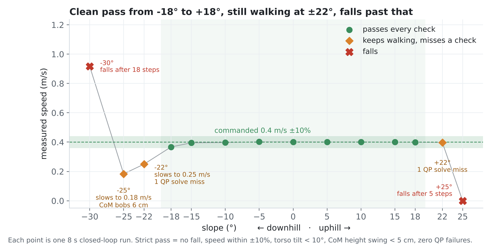
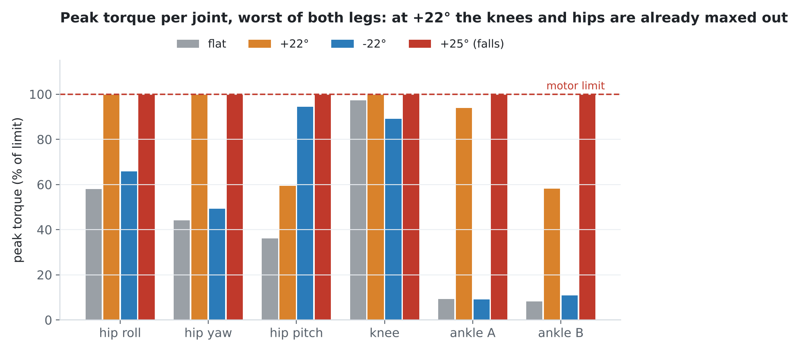
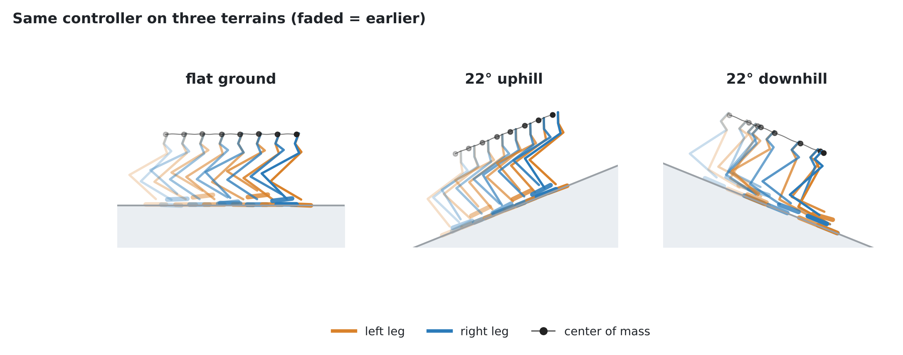
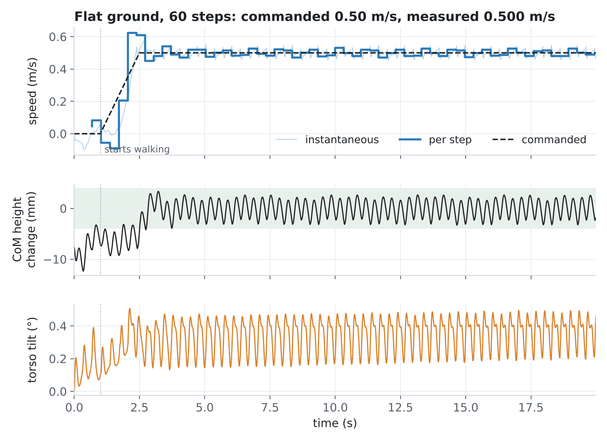
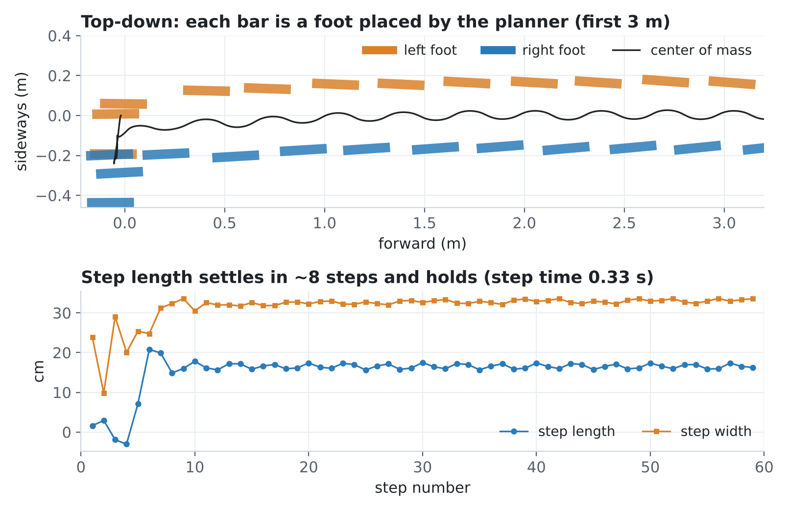
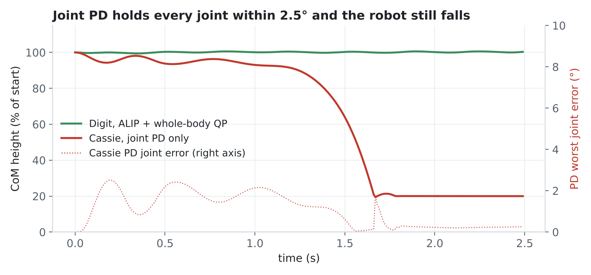

<div align="center">

# ALIP Walking Control for the Digit Humanoid

**Bipedal walking on flat ground and steep slopes in MuJoCo: an angular-momentum footstep planner paired with a whole-body optimization controller.**


*Live physics: flat ground · 22° uphill · 22° downhill*

</div>

## Overview

This project makes Agility Robotics' **Digit** humanoid walk in simulation, closed loop, with nothing pre-recorded. Every step is decided in real time from the robot's measured state.

The controller has two layers:

- **Where to step: the ALIP planner.** It treats the robot as an inverted pendulum and tracks its angular momentum about the stance foot. From that, it computes in closed form the footstep that keeps the robot balanced one step later.
- **How to move: a whole-body QP.** At 500 Hz, it solves for every joint torque so the body follows the plan while respecting real physics: the feet can only push, friction has limits, and the motors have torque limits.

I extended the planner from flat ground to slopes with one small change to the math, without adding a heavier optimizer.

## Results

| | Result |
|---|---|
| Flat ground | **57 steps / 9 m** without falling, commanded 0.50 m/s, measured 0.499 m/s |
| Stability | body height held to ±4 mm, torso tilt under 0.52° |
| Clean slope range | passes every check from **−18° to +18°** |
| Uphill | keeps walking up **22°** (a 40% grade), 1.42 m of vertical climb |
| Downhill | keeps walking down **22°**, but slows to about 0.25 m/s instead of 0.4 |
| Limits | falls at +25° (knees and hips hit their torque limits), speeds up and falls at −30° (can't brake) |

<p align="center"></p>

**Why it stops at +22°.** By +22° the knees and hips are already at 100% of their motor torque, so there is no headroom left for a steeper grade.

<p align="center"></p>

<p align="center"></p>

**Flat ground, 20 s.** Speed tracks the command once the ramp finishes; height and tilt barely move.

<p align="center"></p>

<p align="center"></p>

**Why foot placement matters.** In the earlier Cassie stage, a plain joint PD controller held every joint within 2.5° and the robot still fell, because nothing was balancing the body over the feet. This project is built around fixing that.

<p align="center"></p>

## How it works

```
 measured state ─► ALIP planner ─► swing-foot targets ─► whole-body QP ─► joint torques ─► Digit (MuJoCo)
      ▲                (where to step)                     (how to move)                        │
      └─────────────────────────────────────────────────────────────────────────────────────────┘
```

- **The planner is robot-agnostic.** The same planner code drove both Cassie and Digit unchanged.
- **Every layer is tested against an independent check:** the math against numerical integration, the dynamics against MuJoCo, and the IK on a fresh model. There are 88 tests in total.

The full write-up, with derivations, the bugs that mattered, and the limitations, is in [docs/PROJECT_REPORT.md](docs/PROJECT_REPORT.md).

## Project structure

```
├── src/        controller: ALIP planner, whole-body QP, IK, state estimation
├── scripts/    runnable experiments: walking, standing, slopes, rendering
├── models/     Digit robot model (MJCF + meshes)
├── images/     GIFs and plots
├── tests/      88 tests
└── docs/       project report
```

## Run it

```bash
bash setup.sh && source .venv/bin/activate
mjpython scripts/play_digit_physics.py --speed 0.5     # watch it walk (Linux: python)
python -m pytest tests -q                               # run the tests
python scripts/make_figures.py --collect                # rerun the sims and redraw every figure above
```

## Credits

- ALIP model: Y. Gong & J. Grizzle, *"One-Step Ahead Prediction of Angular Momentum about the Contact Point for Control of Bipedal Locomotion,"* ICRA 2021
- Digit is a robot by [Agility Robotics](https://agilityrobotics.com). The Cassie model comes from [osudrl/cassie-mujoco-sim](https://github.com/osudrl/cassie-mujoco-sim).
- Simulator: [MuJoCo](https://mujoco.org) · QP solver: [OSQP](https://osqp.org)

Independent project, not affiliated with Agility Robotics. Code is [MIT](LICENSE). Third-party models keep their original terms.

<p align="center">Built by <b>Aditya Rampal</b> · <a href="https://autonomousadi.com">autonomousadi.com</a></p>
