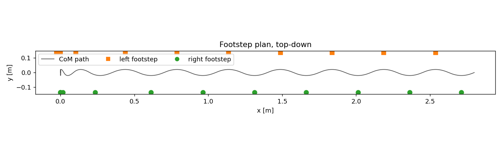
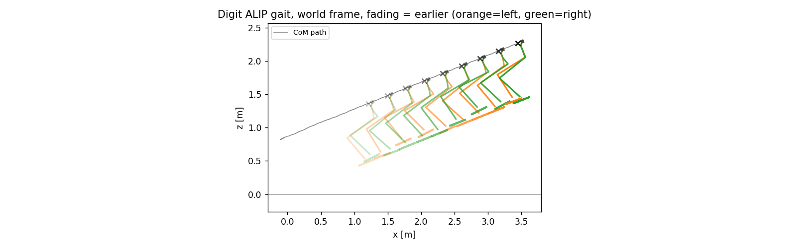
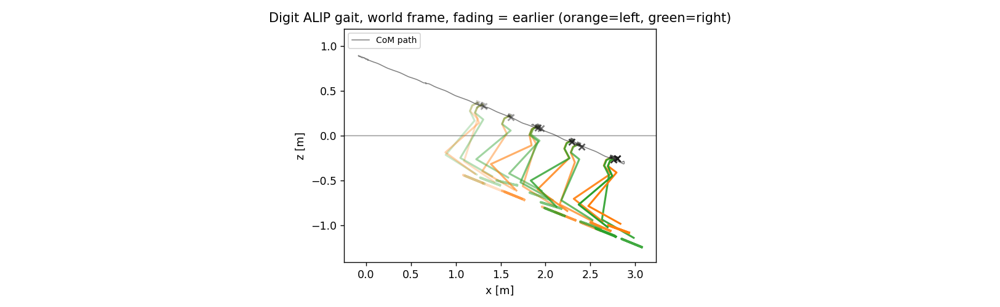
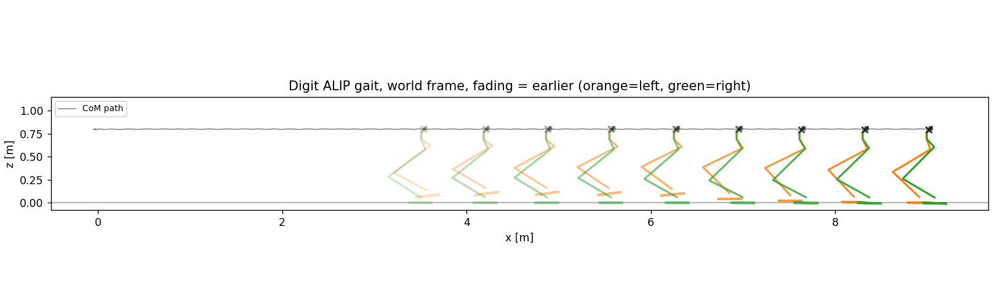

# ALIP Locomotion on Digit — Project Report

Flat ground to ±22° slopes, in MuJoCo. Reduced-order footstep planning with whole-body QP control: what was built, what it measured, and what it cannot do.

**Summary.** A closed-loop walking controller for the Agility Digit humanoid. A reduced-order ALIP planner computes where the next foot goes from measured angular momentum about the contact point; a whole-body quadratic program solves for joint accelerations, contact forces, loop-closure forces and torques subject to the true constrained dynamics, friction cones and actuator limits. Nothing is precomputed. Result: 57 continuous steps on flat ground tracking commanded speed to 0.001 m/s, and slopes to +22° uphill and −22° downhill.

**Contents:** [1. The problem](#1-the-problem) · [2. The robot](#2-the-robot-and-what-the-model-audit-found) · [3. Architecture](#3-architecture) · [4. Flat ground](#4-flat-ground) · [5. Slopes](#5-slopes-upslope-and-downslope) · [6. Validation](#6-validation-methodology) · [7. Limitations](#7-limitations)

---

## 1. The problem

Bipedal walking is hard for four specific reasons:

| Property               | Consequence                                                                                |
|------------------------|--------------------------------------------------------------------------------------------|
| **Underactuated**      | Fewer actuators than DOF. Some motions cannot be commanded at all.                         |
| **Unstable**           | Inverted pendulum — errors grow exponentially. For Digit, doubling every 0.20 s.           |
| **Hybrid**             | Continuous dynamics punctuated by discrete impacts. Stability is *orbital*, not pointwise. |
| **Unilateral contact** | Feet push, never pull. Control authority can vanish and you don't choose when.             |

### The underactuation count

    20 DOF (floating-base model, single support)
      - 4  spring constraints (two per leg)
      - 5  stance foot constraints
     ------
      11  DOF to control
      10  actuators                    -> underactuated by 1

Worse in practice: the stance ankle saturates easily, so it is excluded. That leaves **9 actuators enforcing 9 virtual constraints and 2 uncontrolled DOF** — rotation about the stance foot in the sagittal and frontal planes.

**The hinge of the whole subject.** Those 2 DOF cannot be stabilised by torque. They are stabilised by *where you put your foot*. Foot placement is not a convenience — it is the only authority over the part that decides whether you fall.

### Proof that tracking is not balance

I ran joint PD holding the nominal pose under real physics. The diagnosis matters more than the outcome:

    knee tracking error      2.5 deg    (target -68.7, actual -70)
    spring deflection        2-3 deg
    torque saturation        NONE
    ground reaction          327 N      (= body weight, 327 N)
    pelvis height            1.010 -> 0.168 m over 1.6 s

<p align="center"></p>

*Joint PD, real physics. The legs hold the same shape in every pose — this is pure toppling, not buckling. The CoM traces a clean arc from 0.88 m to 0.17 m, travelling 1.1 m horizontally before landing face-down.*

The legs track essentially perfectly and she falls anyway, because nothing regulates the CoM over the support polygon. **Trajectory tracking and balance are different problems.**

---

## 2. The robot, and what the model audit found

|               |                                                                     |
|---------------|---------------------------------------------------------------------|
| Mass          | 50.07 kg (torso alone 17.17 kg)                                     |
| CoM height    | 0.80 m above the soles, standing                                    |
| Step width    | 0.26 m                                                              |
| DOF           | 50 in this MJCF (30 on hardware), $n_q$ = 57 — quaternions      |
| Actuators     | 20 real (6 per leg, 4 per arm)                                      |
| Torque limits | knee 231, hip pitch 216, hip roll 126, hip yaw 79, **toe 41 N·m**   |
| Foot          | box, 23.5 × 8 cm — a real support polygon, 188 cm²                  |
| Closed chains | 6 `connect` constraints, 18 scalar rows (achilles + toe A/B rods) |

Auditing the MJCF before trusting it surfaced four things that would each have caused silent failure:

**1. The collision box carries a 60° rotation.** `euler='-1.047 0 0'`, so the sole normal is $(0, 0.866, 0.5)$ in the body frame, not body $+z$. Reading only `geom_pos` and `geom_size` gave an IK that converged to **0.0000 mm position error with the foot tilted 50°**.

**2. The geom eulers are mirrored between sides** ($-60^\circ$ left, $+60^\circ$ right), so the geom's $+y$ axis points in *opposite world directions* on the two feet — left 179.27°, right 0.73°. A yaw target of 0 therefore demanded a 180° flip and pinned `left_hip_yaw` at its limit for the entire gait.

**3. The MJCF actuates dependent coordinates.** `tarsus`, `toe_pitch` and `toe_roll` all carry actuators, but on hardware tarsus is passive and toe pitch/roll are driven *through* the toe A/B differential. Commanding them is physically fictitious — 26 actuators reduced to 20.

**4. It declares no torque limits at all.** `ctrllimited=False` with `ctrlrange=[0,0]` means unbounded torque. Agility's real limits were imposed manually.

---

## 3. Architecture

### Layer 1 — reduced-order planner

Model the 50-DOF robot as a point mass on a massless leg. Track angular momentum about the contact point. Solve in closed form for the footstep that puts that momentum on target one step later. Robot-agnostic: the same module drove both Cassie and Digit, unchanged.

### Layer 2 — whole-body QP controller

Decision variable, solved every control tick:

```math
z = \big[\;\ddot q\;(50) \;\big|\; \lambda_{c}\;(12\text{–}24) \;\big|\; \lambda_{eq}\;(18) \;\big|\; \tau\;(20)\;\big]
```

**Equality constraints** — what must be true:

```math
\begin{aligned}
M\ddot q + h &= B\tau + J_c^\top\lambda_c + J_{eq}^\top\lambda_{eq} &&\text{(dynamics)}\\
J_s\ddot q + \dot J_s\dot q &= 0 &&\text{(stance foot does not move)}\\
J_{eq}\ddot q + \dot J_{eq}\dot q &= 0 &&\text{(four-bars stay assembled)}
\end{aligned}
```

**Inequality constraints** — physical limits:

```math
f_z \ge 0, \qquad \|f_{xy}\| \le \mu f_z, \qquad |\tau| \le \tau_{max}
```

**Cost** — weighted tasks: CoM height, torso orientation, swing foot pose, posture regularisation.

**Why a QP and not a matrix solve?** Because the binding limits are *inequalities*. Both things that killed joint PD — contacts cannot pull, torque saturates — are inequality constraints. A QP plans *within* them; a PD loop discovers them by falling over.

**Second reason:** with four contact points per foot, the QP implicitly chooses *where under the foot* to place the load. That is centre-of-pressure regulation, and it is the extra authority Digit's box foot has that a line-contact foot does not.

---

## 4. Flat ground

### 4.1 The model

CoM at constant height $H$, position $r=(x,y,H)$ relative to the stance contact point, velocity $v=(\dot x,\dot y,0)$. Angular momentum and gravity torque are both cross products:

```math
L = r\times mv \;\Rightarrow\; L_y = mH\dot x,\quad L_x = -mH\dot y
```
 
```math
\tau = r\times(0,0,-mg) \;\Rightarrow\; \dot L_y = mgx,\quad \dot L_x = -mgy
```

Each plane is an independent 2-state linear system. Closed-form flow over a step of duration $T$, with $\omega=\sqrt{g/H}$:

```math
\begin{aligned}
x(T) &= \cosh(\omega T)x_0 + \tfrac{\sinh(\omega T)}{mH\omega}L_0\\
L(T) &= mH\omega\sinh(\omega T)x_0 + \cosh(\omega T)L_0
\end{aligned}
```

$\cosh$ rather than $\cos$ because the eigenvalues are real ($\pm\omega$) — a saddle, not a centre. Digit's $\omega = 3.50\ \mathrm{s^{-1}}$: errors double every 0.20 s.

### 4.2 Why angular momentum, not velocity

**Impact invariance.** The impulsive contact force acts *at* the contact point, so $r=0$, so $r\times F = 0$ — no torque, therefore no change in $L$. The forces that decelerate the torso are *internal*, and internal forces cancel in pairs, contributing no net torque about any point.

So $L$ passes through foot-strike continuously. The reset map is literally `return pos - step, L`. That continuity is what keeps the step-to-step map linear and makes a closed-form deadbeat law possible.

Secondary reason, and the practical one on hardware: $\dot L = mgx$ depends only on *geometry*, whereas CoM acceleration needs force sensing or double differentiation.

### 4.3 The foot placement law

Impose that $L$ at the end of the *next* step equals a target, and solve the resulting linear equation for the footstep displacement $p$:

```math
\boxed{\;p = x(T) + \frac{\cosh(\omega T)L(T) - L_{des}}{mH\omega\sinh(\omega T)}\;}
```

**Deadbeat in one step** — not asymptotic, exact. Verified to $10^{-9}$.

Laterally the target must alternate, or the robot topples sideways or walks its feet together. Imposing mirror symmetry and $L_x(T)=-L_x(0)$ gives, for left stance:

```math
y(0) = -\frac{W}{2}, \qquad L_x^{des} = +\tfrac12 mH\omega W\tanh(\omega T/2)
```

<p align="center"></p>

*Stage 1: the planner validated on a point mass before touching the robot. Commanded 0.500 m/s, measured 0.500. Step width 0.2699 m against a nominal 0.27. Lateral drift at machine precision (6e-16). Tight cluster on the left is walking in place; even spacing is cruise.*

### 4.4 Result

<p align="center"></p>

*57 steps, 9.04 m, commanded 0.500 m/s and measured 0.499. Footprints are real support polygons — the box foot — with the CoM weaving between them.*

| Metric               | Result              |
|----------------------|---------------------|
| Steps / distance     | 57 / 9.04 m in 20 s |
| Commanded → measured | 0.500 → 0.499 m/s   |
| CoM height variation | ±4 mm               |
| Torso tilt           | 0.52° max           |
| QP failures          | 0                   |

### 4.5 The three bugs that mattered

**Unmodelled stance ankle torque (599 mm → 2 mm drift).** She drifted backwards at 0.36 m/s on a zero command. Rather than tune, I tested whether the ALIP model *predicted* the robot over one step: end-of-step momentum came out 2–4× more negative than predicted, while $H$ was accurate to 0.6 cm. The planner assumes $\dot L = mgx$ — *no ankle term* — but the OSC was saturating all four toe motors at 41 N·m. A saturated ankle over 0.35 s gives $\Delta L \approx 14$–$20$, exactly the discrepancy. Suppressing stance ankle torque fixed it — and this is precisely what Gong & Grizzle prescribe.

**Rank-deficient constraints (QP infeasible).** I constrained all four sole corners to zero acceleration: 12 rows per foot, of which only **6** are independent, because a planted foot is a rigid body. In exact arithmetic the redundant rows agree; with finite-differenced drift terms carrying ~$10^{-3}$ noise they contradict, and OSQP correctly reported primal infeasibility. The controller then silently froze at its last good solve. Fixed by constraining the foot *body's* 6-DOF acceleration while keeping per-corner forces, so CoP and friction cones survive.

**Swing overshoot (0.382 → 0.499 m/s).** I predicted under-stepping; measurement showed the foot landed **19 mm past** target, because the footstep was re-planned right up to touchdown so the foot chased a moving goal. Overshoot puts the contact point ahead of plan, which *decelerates*. At $mH\omega\sinh(\omega T) = 220$ kg·m²/s per metre of placement error, millimetres matter.

---

## 5. Slopes: upslope and downslope

### 5.1 The derivation — one new term

Work in coordinates aligned with the surface. Gravity splits into a component along the surface normal and one down the slope, so the sagittal dynamics gain a *constant*:

```math
\dot L = \underbrace{mg\cos\gamma\;x}_{\text{flat-ground term}} \;-\; \underbrace{mgH\sin\gamma}_{\textbf{new: constant downhill bias}}
```

Two consequences of wildly different magnitude:

| Effect                  | Size at 10° | Verdict                                              |
|-------------------------|-------------|------------------------------------------------------|
| $\omega \to \sqrt{g\cos\gamma/H}$               | 0.8% change | negligible                                           |
| constant bias $mgH\sin\gamma$ | **68 N·m**  | larger than the ~25 N·m restoring torque it perturbs |

**The key result.** The system is now *affine*, not nonlinear. Setting $\dot L = 0$ gives the equilibrium

```math
x^{*} = H\tan\gamma
```

and substituting $\zeta = x - x^{*}$ recovers the flat-ground equations **exactly**. So the entire flat toolkit — closed-form flow, deadbeat placement, periodic orbits, the lateral sway term — transfers unchanged. **Slopes cost two substitutions.**

**Physical reading of $x^{*}$:** the CoM must ride *uphill* of the stance foot by $H\tan\gamma$. At 10° that is **14.1 cm** — which exceeds the foot's half-length of 11.75 cm. Digit therefore *cannot stand still* on a 10° grade with level feet; she must stagger her stance or keep stepping. Exactly what people do on hills.

### 5.2 Why a ramp does not need the stair-climbing machinery

The variable-pendulum-length ALIP of the stair literature exists because stairs make $r_c$ vary *within* a step, destroying time-invariance and the closed form — hence MPC. A constant grade never does that.

|                     | Stairs (the paper)              | Ramps (this work)                    |
|---------------------|---------------------------------|--------------------------------------|
| Geometry            | discrete treads                 | continuous grade                     |
| Model               | variable-length, $r_c(t)$, LTV | constant-height + affine shift, LTI  |
| Sagittal control    | **MPC on ankle torque**         | **foot placement, ankle suppressed** |
| Online optimisation | required                        | none — closed form                   |

Note the two approaches take *opposite* forks on the central design question. Stairs remove foot placement, so they must use the ankle. Ramps preserve it, so the ankle can be suppressed — which is desirable, since it is the weakest actuator.

### 5.3 Results

<p align="center"></p>

*+22° (40% grade): 33 steps, 3.79 m along the slope, **1.42 m of vertical climb**, tracking 0.402 m/s against 0.400 commanded.*

<p align="center"></p>

*−22°: 31 steps, 2.99 m, 1.12 m descent. 39% of steps register as _late_ touchdown — the downhill signature.*

| Grade | Result                   | Limiting factor      |
|-------|--------------------------|----------------------|
| +22°  | walks, 0.402 / 0.400 m/s | —                    |
| +25°  | **falls**                | knee torque, 231 N·m |
| −22°  | walks                    | —                    |
| −30°  | **runaway to 1.27 m/s**  | braking authority    |

**The asymmetry is the physically interesting result.** Uphill fails by *falling* — she cannot generate enough propulsion, and the knees saturate. Downhill fails by *not tracking* — foot placement alone cannot brake, and she accelerates away from the command. Different failure modes, different fixes. Downhill is exactly where ankle-torque MPC would earn its keep.

### 5.4 An independent check on the slope model

The slope is implemented by rotating gravity rather than tilting the floor — exactly equivalent, and it leaves the nominal pose, the flat-foot target and all contact geometry unchanged. Measured ground reaction validates it:

| Grade | Measured $F_z/W$ | $\cos\gamma$ |
|-------|--------------------|-----------|
| +22°  | 0.926              | 0.927     |
| +10°  | 0.987              | 0.985     |
| 0°    | 1.000              | 1.000     |
| −22°  | 0.926              | 0.927     |

Agreement to 0.2%, and nothing in the controller was told to produce it.

### 5.5 A measurement mistake worth admitting

I first reported an uphill limit of **13–14°**. That was wrong — it was measuring my *initial condition*, not the controller. Starting from the flat-ground nominal pose put her 14 cm off the slope's equilibrium, so she slid ~0.5 m downhill acquiring the lean and died during that transient. Initialising on the slope's own periodic orbit dropped the backslide from 0.454 m to 0.032 m, and the real limit turned out to be **22°**.

*When you measure a failure boundary, make sure you are measuring the controller and not your own setup.*

---

## 6. Validation methodology

Every layer was checked against an independent oracle before anything was built on top of it. This is what makes the numbers believable.

| Layer                                            | Oracle                                    | Agreement                    |
|--------------------------------------------------|-------------------------------------------|------------------------------|
| ALIP closed form                                 | RK4 with 200,000 steps                    | 1e-9                         |
| Dynamics ($M$, bias, $B$, Jacobians) | MuJoCo's own $\ddot q$                    | 1e-8                         |
| Drift terms $\dot J\dot q$                            | central difference of point position      | 2e-3 rel                     |
| IK solutions                                     | re-evaluated on a separate model instance | \<1e-4 m                     |
| Angular momentum                                 | hand-rolled sum over all 38 bodies        | 1e-8                         |
| Push recovery                                    | capture-point bound $\xi = x + v/\omega$             | 65% of theory, CoP saturated |

<p align="center"></p>

*Flat ground, world frame. CoM held to ±4 mm over 9 m of travel.*

### The debugging method

**Predict, measure, compare — never gain-twiddling.** Every diagnosis in this project came from asking "does the model predict what the robot actually did?" and looking at the residual. The stance-ankle bug was found in a single experiment that way; tuning would have chased it indefinitely.

Worth noting: *every time I guessed, I was wrong.* I predicted under-stepping (it was overshoot), a mistuned QP (it was rank-deficient), and a sound model (it was missing a torque term).

---

## 7. Limitations

| Limitation                | Why it matters                                                                                                                                                                            |
|---------------------------|-------------------------------------------------------------------------------------------------------------------------------------------------------------------------------------------|
| **Ground-truth state**    | The planner reads CoM and angular momentum from the simulator. No robot has that. Real systems need a Kalman filter fusing IMU and encoders — this is the single biggest gap to hardware. |
| **Known, constant grade** | The planner is *told* $\gamma$. Real terrain is unknown and varies. This assumes away most of what makes slopes hard in practice.                                                        |
| **No turning**            | Torso yaw is fixed; she walks in straight lines only.                                                                                                                                     |
| **Simulation only**       | Contact, torque limits and closed chains are modelled, but it is still MuJoCo, not hardware.                                                                                              |
| **Idealised impact**      | The reset map assumes instantaneous foot swap. Double support exists but is brief and simple.                                                                                             |

---
